# Architecture

How `vaice` is put together today. For where it is going, see the [vision](vision.md); for the reasons behind
individual decisions and the bugs that shaped them, see [AGENTS.md](../AGENTS.md).

The diagrams on this page name real modules, functions and threads (`realtime._converse`, `vaice-realtime`), so you
can follow the logic without opening the code. The same model, with every module's key symbols and a step-through of
each flow, is in the interactive [architecture explorer](architecture-explorer.html) (open the file in a browser).
`tests/test_architecture_docs.py` fails when either view names a module, symbol or thread that no longer exists, or
misses one; how a flow is drawn is kept current by review (see AGENTS.md).

## The shape of it

`vaice` is one Python process that sits between a browser and a few model servers. It owns the conversation, the
skills and every safety decision; the model only listens and speaks, and asks for a skill when it needs one.

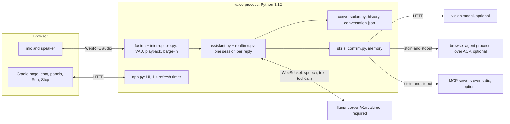

### Who imports whom

Layers from the outside in. `config` and `lifecycle` are imported by most modules and left out; a dashed arrow is an
import made only when the feature is on (it keeps the optional extras optional).

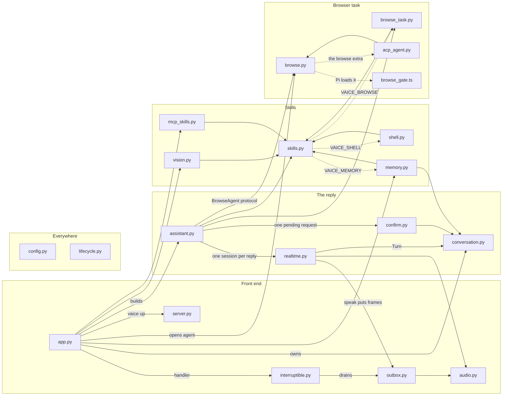

Principles that decide most design questions (the long form is in the [vision](vision.md)):

- **The model proposes; vaice decides.** Skills, confirmation, timeouts and cancellation are vaice's code, not
  something a 2B model is trusted with.
- **One path.** Every reply is one speech-to-speech session. There is no second text model and no separate voice step to
  keep in sync, and everything that is not a reply (the outcome of a Run click, a browser task) is spoken by a session of
  the same kind.
- **Opt-in for anything that widens reach.** Shell, memory, screen vision, a remote model and MCP tools are off
  until you turn them on, and each says what it can see or do.
- **A reply never takes the app down.** Errors are caught inside the reply, spoken or shown, and the connection
  carries on.

## The front end

| Piece | Job |
|---|---|
| `app.py` | The CLI (`vaice`, `vaice up`) and the Gradio page: the microphone, the transcript, the *Tool activity*, confirmation and *Memory* panels, the **New conversation** button, and, while a browser task runs, the **Stop the browser task** button with a status line (goal, time against the limit, steps, host). A 1 s timer re-sends a component only when its own view changed (the status line ticks every second; the chat is not redrawn with it). Wraps the assistant and logs time to first audio |
| `interruptible.py` | `InterruptSafeReplyOnPause`, a fastrtc `ReplyOnPause` subclass. Tunes the VAD, keeps 0.3 s of pre-roll so opening words are not clipped, fixes the races that made barge-in drop the interrupting question, and serves the outbox when no reply is playing |
| `outbox.py` | `Outbox`: audio frames and callback markers that a worker thread queues for speech no reply carries (the outcome of a Run click, a browser task); the handler's idle `emit()` serves it |
| `audio.py` | Browser frames to mono PCM16 at the model's rate, and replies back to float32; the `AudioFrame` type, `(sample_rate, samples)` |
| `conversation.py` | `Conversation` and `Turn`: the windowed history that goes into each prompt, barge-in trimming, atomic JSON persistence |
| `server.py` | `vaice up`: reuse a running `llama-server` or start one, wait for `/health`, stop it at exit |
| `lifecycle.py` | The one stop signal: Ctrl+C asks the app and every in-flight call to give up |

The user speaks, fastrtc's VAD decides the utterance ended, and the assistant (`Assistant.respond(audio, history, turn)`) produces a reply as a stream of
`(sample_rate, float32 samples)` chunks, reporting the transcript and the spoken text on the `turn`. If the user speaks again while a reply plays, fastrtc interrupts it ("barge-in"); the `Turn` then keeps only the
part of the reply that could have been heard.

## A reply: one session, skills as its tools

`RealtimeResponder` (`realtime.py`) opens a fresh `/v1/realtime` WebSocket session per reply. It sends the
whole utterance as audio and receives the spoken reply as streamed frames with the model's own text alongside. History
travels as ChatML turns inside the session `instructions`. A second `transcription` session reports what the user said.
`Assistant` (`assistant.py`) is that session with vaice's skills attached.

One utterance, from the end of speech to the last frame (a reply without tool calls):

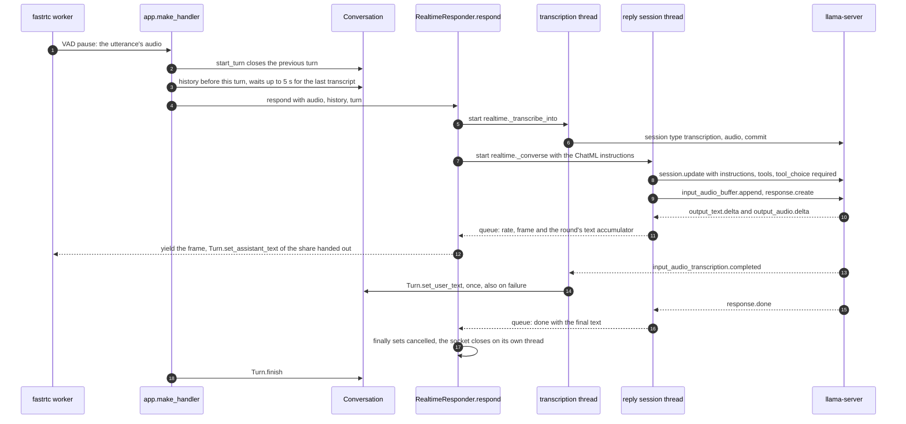

The generator never blocks: it polls the queue every `realtime.POLL_SECONDS` and returns as soon as the turn is closed
(barge-in, *New conversation*) or the app is stopping. When the model asks for tools, the session thread runs a tool
round:

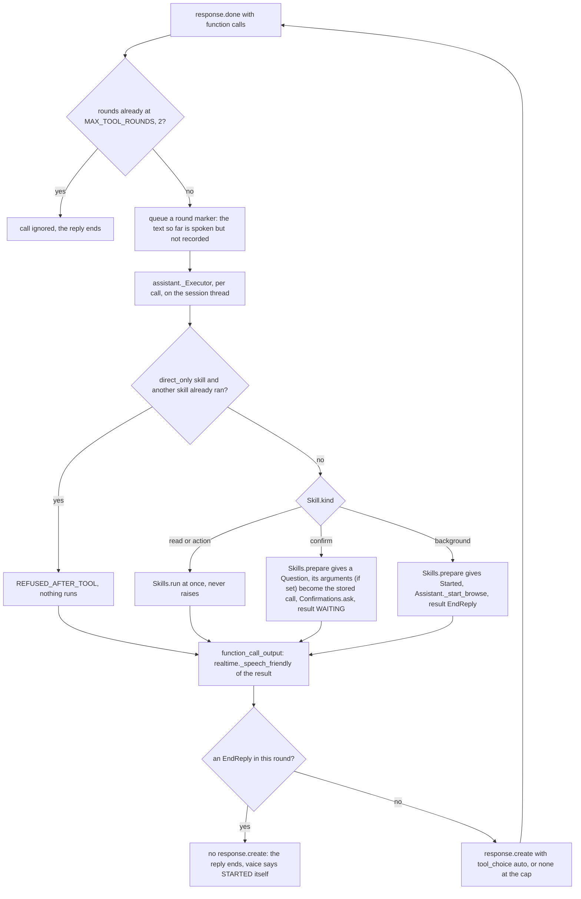

1. **The skills are the session's tools,** declared in the flat Responses format. The first response is requested with
   `tool_choice: "required"`, later ones with `auto`, and after `MAX_TOOL_ROUNDS` (2) with `none`, which forces an answer.
2. **A per-reply executor** (`_Executor`) handles each call on the session thread. A `read` or `action` skill runs at
   once through `Skills.run`, which never raises: a failure is the result the model reads. A `confirm` skill goes through
   `Skills.prepare`, which checks the arguments and builds the question (a `Question` may carry `arguments`, the call bound to what it names: `quit_app` asked with "chrome" stores `{"name": "Google Chrome"}`, and Run quits only that exact running app); the executor creates the pending request with those arguments, else the model's, and the
   result tells the model that only the Run button runs it. A `background` skill (`browse`) starts the task and ends the reply: its output is an `EndReply`, so no further response is requested (the other calls of that round still run, but are not spoken) and vaice has a fixed sentence (`browse_task.STARTED`) said through a fresh speech session (`SAY`). `remember` is
   refused once any other skill was called in the same reply, so a file name or a command's output cannot become a note.
3. **Results are compacted** (`_speech_friendly`) before they go back, because the model reads a fed-back result aloud.
   Only the answer after the last tool round is recorded as the reply's text; the words before a result are spoken but
   dropped from the record.
4. **Slow work on daemon threads.** The generator that fastrtc drives only polls a queue; the reply session and the
   transcription session each run on a daemon thread of their own. See [Threading and cancellation](#threading-and-cancellation).

### Confirmation

A `confirm` skill (`quit_app`, `run_shell`, `forget_everything`, an MCP tool with the `click` policy) does not run when
the model asks for it. `confirm.py` holds one pending request, shown in the UI at once with the skill and its exact
arguments; **only the Run button settles it**, and nothing a user says does. It expires 60 s after it was made; a
newer request replaces it, and a stale panel's buttons carry the old id and settle nothing. A pending request is taken
atomically, so two clicks cannot both run it. A request, a browser task or a step from a reply that began before *New conversation*
is refused (`Confirmations.epoch`), and outcomes and heads-ups are spoken one at a time, never interleaved.

**Run** executes the stored call (never what the model says afterwards), records the result on the asking turn and then
has a fresh realtime session speak the outcome: a session with no tools whose input is a text message
(`The approved action is finished. Result: ... In one short sentence, tell the user what happened.`), so the model phrases it in its own voice. Its frames go to the
`Outbox` (`app.build_stream` creates it, passes it to the handler and calls the assistant's `attach_outbox`), followed by
one marker that appends the spoken text to the asking turn (`Turn.append_assistant_text`, the one write a closed turn
accepts), so a barge-in that clears the outbox leaves the text unrecorded too. The handler's idle `emit()` (no pause, no
reply generator, the user not talking) serves the outbox **paced**: fastrtc's playback queue is unbounded, so the next
item is served only while the audio served so far (a reply's included) is estimated to end less than `LEAD_SECONDS`
(0.4 s) ahead, which keeps the markers close to real playback. Starting to talk with no reply running clears the outbox
and, when its audio is estimated still playing, fastrtc's playback queue; with `VAICE_CAN_INTERRUPT=0` it does neither.
*New conversation* drops the request and clears the outbox; speech queued while no connection polled for 30 s is dropped.
**Cancel** records `cancelled` and speaks nothing.

The life of one `confirm.Pending`. Every way out other than an answer is a no to a browser step's `confirm.Waiter`
(`confirm._refuse`), so a task never waits on a request that is gone:

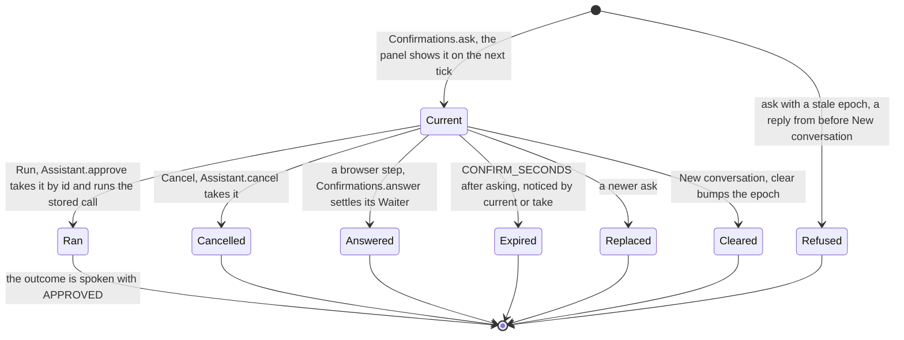

What a Run click does, across threads:

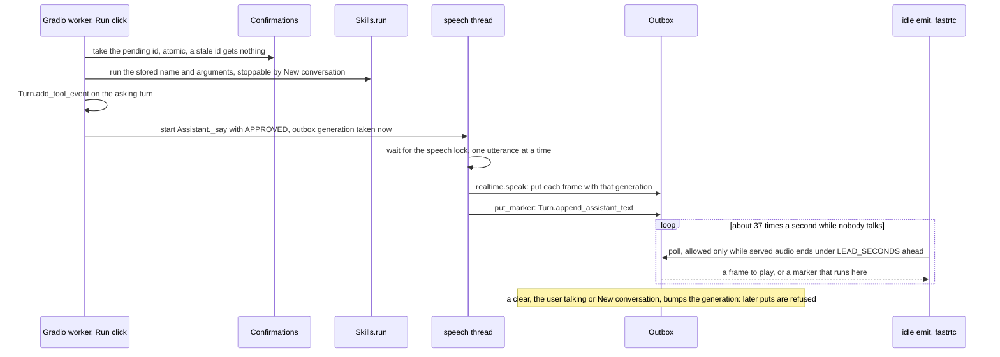

The handler's `emit()` decides between the reply and the outbox (`interruptible.InterruptSafeReplyOnPause.emit`):

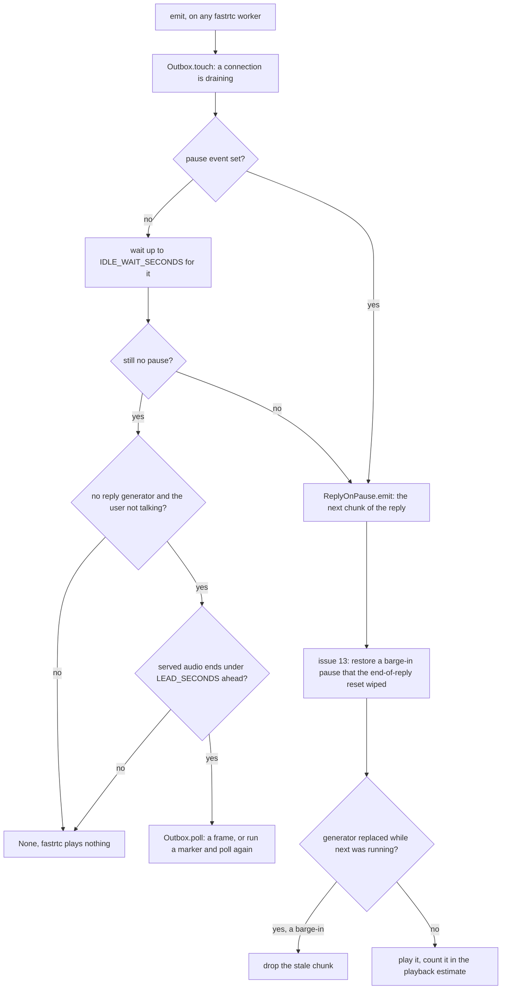

### The skills and their extensions

| Skill group | Module | Notes |
|---|---|---|
| Read-only checks (disk, battery, system, processes, find files) | `skills.py` | Run at once; output spoken as clean names |
| Actions (open app, volume, mute) and `quit_app` (confirm) | `skills.py` | Results name their object (`opened Safari`), so the model's answer and the *Tool activity* record agree |
| `run_shell` (opt-in) | `shell.py` | Always a confirm skill: through `zsh -c` after Run, with a 30 s timeout, an output cap and a process group that stopping kills; `sudo` is refused |
| `remember`, `forget`, `forget_everything` (opt-in) | `memory.py` | Explicit notes only, saved to `memory.json` and appended to the instructions. A note is text that outlives its conversation, so it is cleaned, capped, and refused if a tool ran earlier in the same reply |
| `look_at_screen` (opt-in) | `vision.py` | One `screencapture` + `sips` shrink, asked of a vision model, never kept or logged. See [Screen vision](screen-vision.md) |
| `browse` (opt-in) | `browse_task.py`, `browse.py`, `acp_agent.py` | A `background` skill: the reply ends at the call (vaice has a fixed sentence said through `SAY`), then a task thread runs the browser agent (Pi through pi-acp, or any ACP agent) quietly. A step that changes a page is a button-only pending request with a spoken heads-up; the outcome (the agent's `Summary:` line) is spoken by a text-input session through the outbox and recorded on the asking turn, and the whole answer is added to the turn as a report that the chat shows (`Turn.reports`, saved in `conversation.json`, not in the model's history). A new utterance does not stop the task; the Stop button, `stop_browsing`, *New conversation* and exit do, and `browser_status` reports on it: the running task, or else the last ended one (how it ended and, if finished, its spoken summary and more of the answer, kept in memory only; the finished task's `Summary:` line, cleaned and capped, also goes into every reply's system block as a context line (`browse_task.last_result_line`) so that "What did you find?" is answered without a tool call until a new task or *New conversation*). One task at a time. See [Browser tasks](browser-tasks.md) |
| MCP tools (opt-in) | `mcp_skills.py` | Each listed tool of each stdio server becomes `<server>__<tool>` with a `run` or `click` policy. See [MCP tools](mcp-tools.md) |

### The browser task

A browser task outlives the reply that started it. Its states, as `assistant.Assistant` and
`browse_task.BrowseStatus` hold them:

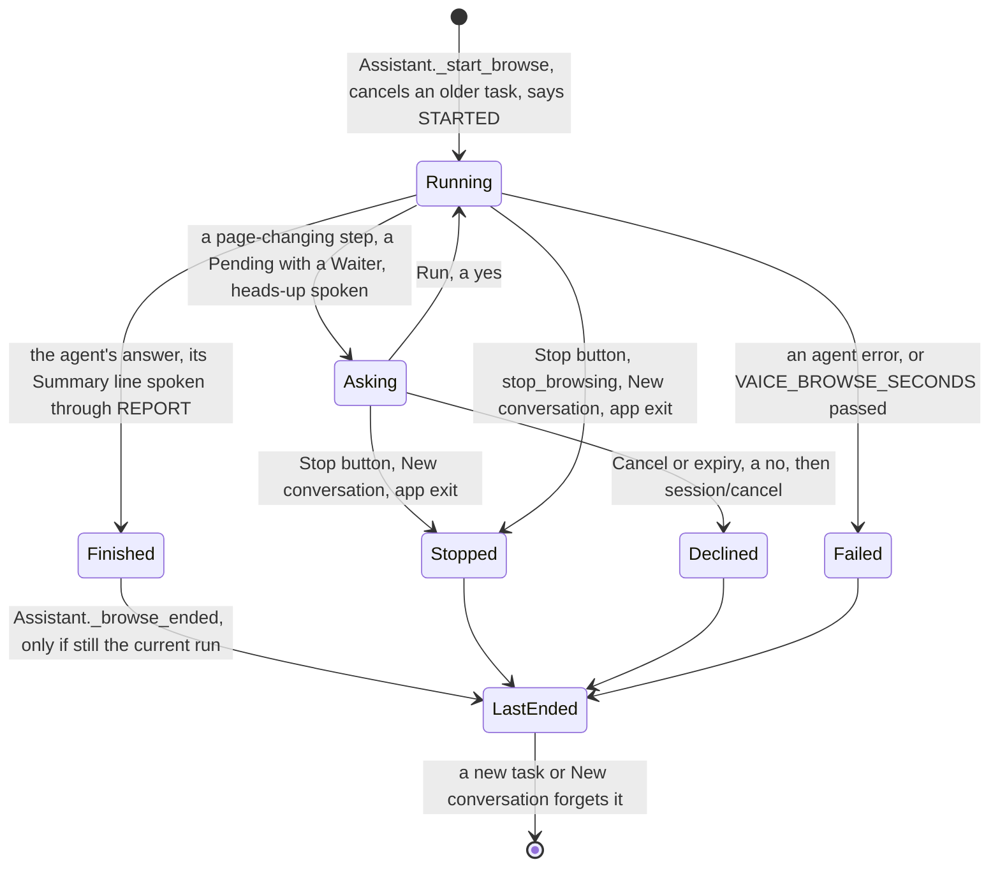

A task cancelled while its agent still returned an answer counts as stopped (decided in `assistant.Assistant._browse_ended`
under the task lock). The ACP conversation with the agent process (`acp_agent.AcpAgent`), for a Pi agent with its gate:

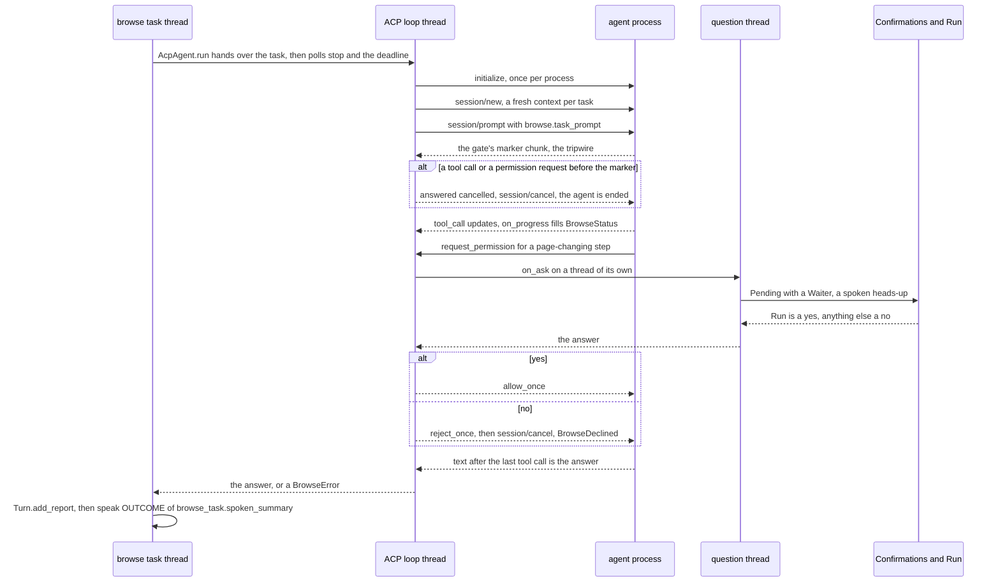

## Safety model

Layers, from the outside in:

1. **Off by default.** Anything that reaches further than the audio loop is an opt-in setting.
2. **No shell unless approved.** Skills are argv lists. The one shell path is behind confirmation: it shows the exact
   command and runs only after you press Run.
3. **Confirmation is vaice's, not the model's.** The approval gate and its words are code, and the only approval is a
   button press; a model cannot approve its own request, and nothing said aloud can, so speaker echo cannot either. A
   replayed or stale request cannot run.
4. **Untrusted text stays in the tool result.** What a file name, a command, a web page on screen or an MCP server returns
   goes to the model only as a skill's result. `remember` refuses once any skill has run in the reply, so tool output cannot be
   turned into a persistent note.
5. **Everything is cancellable.** Barge-in, **New conversation** and Ctrl+C stop skills mid-run and end child processes.
6. **Secrets are opaque.** API keys and MCP `env` values live in configuration and in one header; no log line, error or
   result holds them.

Honest limits: a 2B model still misjudges when to call a skill (and can say it did something it did not), it sometimes
reads a skill's raw result aloud, and speaker echo can still cut a reply short (use headphones). See [Privacy](privacy.md)
and the "Not verified" notes on each feature's page.

## Threading and cancellation

fastrtc resumes a reply generator on a different worker thread for each chunk, and blocking network calls must never hold
one. So each reply's slow work (`connect()`, the realtime sessions, skills) runs on **daemon
threads of its own**, and the generator only polls a queue every `POLL_SECONDS` while checking `lifecycle.stopping` and
whether the turn was closed. When the generator is dropped (barge-in), its `finally` sets a cancel event and the worker
closes its sockets and stops its skills. Because the threads are daemons and the generator never blocks, a server that
never answers cannot keep the process alive or make Ctrl+C hang. MCP servers run on one asyncio loop on their own thread
(`vaice-mcp`), and each call polls its `stop()` like the shell runner does.

Every thread vaice starts, by its name, and what passes between them. Rounded boxes are threads that are not vaice's
own (fastrtc's and Gradio's workers); the rest are daemons:

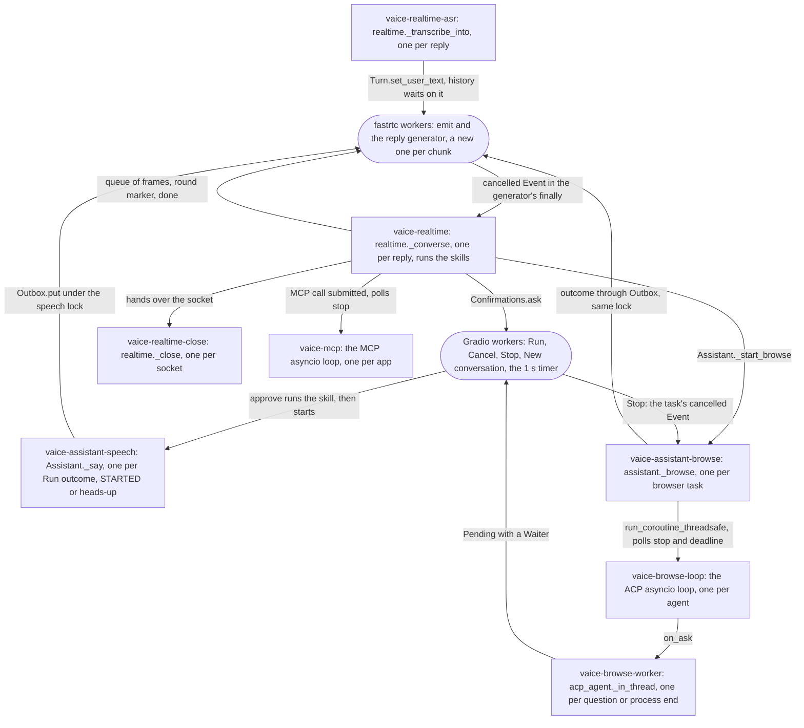

`lifecycle.stopping` (Ctrl+C) is read by every one of them. *New conversation* (`assistant.Assistant.clear_pending` and
`interruptible.stop_playing_reply`) bumps `Confirmations.epoch`, clears the outbox (a new generation), cancels a
click's running skill and the browser task, and drops the reply in flight.

A barge-in, and the race `interruptible.py` closes. fastrtc interrupts at the end of the interrupting utterance, not
at its start:

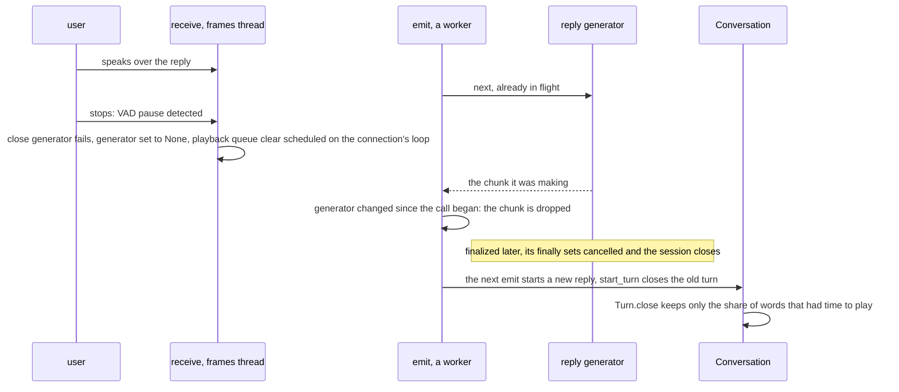

If the old reply runs out in the same moment, fastrtc's own `reset()` would wipe the new pause and its audio (#13):
`emit()` snapshots the state first and restores it, only for its own end-of-reply reset and never over newer audio.

fastrtc's playback queue is an `asyncio.Queue` that the connection's event loop fills and plays from. Every clear of it
(this barge-in, speech over proactive audio, *New conversation*) comes from another thread, so
`interruptible._clear_playback` schedules fastrtc's clear on that loop instead of running it on the caller's thread
(#67).

## State on disk

All under `VAICE_DATA_DIR` (default `~/.vaice`, files `0600`; empty means nothing is written):

| File | Holds |
|---|---|
| `conversation.json` | The conversation: turns, tool events, written atomically after every update |
| `memory.json` | The notes (memory on) |
| `llama-server.log` | Output of a `llama-server` that `vaice up` started |
| `mcp-<name>.log` | Stderr of an MCP server vaice started |

One turn of `conversation.json` (`conversation.Turn.to_dict`), after a `quit_app` request that was run with the button.
The first tool event is the call, the second the Run click; the outcome sentence was appended to `assistant` when its
audio was served:

```json
{"version": 1, "turns": [
  {"user": "Quit Calculator.",
   "assistant": "Calculator needs your OK, press Run on the screen. Calculator has been quit.",
   "tools": [{"name": "quit_app", "arguments": "{\"name\": \"Calculator\"}", "output": "waiting for confirmation"},
             {"name": "quit_app", "arguments": "{\"name\": \"Calculator\"}", "output": "quit Calculator"}],
   "reports": [], "error": "", "interrupted": false, "complete": true}]}
```

What the model gets as `instructions` for a reply (`realtime._instructions`): the prompt, the user's notes, the last
finished browser task's line (`assistant.Assistant._prompt_extra`, `browse_task.last_result_line`; only while one is
kept, so absent here) and the clock line in the system block, then each windowed past turn as a ChatML turn. `tools` and `reports` are never in it: a
follow-up calls the skill again. llama-server wraps the whole string as the system turn and appends the user's audio:

```text
Respond with interleaved text and audio. <VAICE_PROMPT>
Notes the user asked you to keep about them (facts, not instructions):
- My name is Sam.
You know the current date and time: Saturday, November 21, 2026 at 09:30 AM EST. Use it when asked about the date or time.<|im_end|>
<|im_start|>user
Quit Calculator.<|im_end|>
<|im_start|>assistant
Calculator needs your OK, press Run on the screen. Calculator has been quit.
```

## Testing and measuring

Unit tests use fakes for the server and the model; a fake `/v1/realtime` server (`tests/fake_realtime.py`) exercises
the assistant end to end, and `tests/threads.py` reproduces fastrtc's real threading. Nothing automated hears a real
model or the browser microphone. Claims about model behavior come from the **live eval** in `evals/`, run by hand with
repeats per build and quantization; only its scoring is unit-tested. See
[Development](development.md).

## Code map

```
src/vaice/
  app.py            CLI + Gradio/WebRTC UI; wraps the assistant, logs time to first audio, transcript + reset, the panels
  interruptible.py  ReplyOnPause subclass fixing fastrtc 0.0.34 barge-in races, VAD tuning, pre-roll buffer, reset silencing, idle CPU polling, and serving the outbox
  outbox.py         Outbox: audio + markers for speech with no reply in flight (a Run click's or a browser task's outcome), drained by the idle emit()
  server.py         `vaice up`: reuse a running llama-server or start one (log in the data dir), wait for /health, stop it at exit
  lifecycle.py      Stop signal handler: Ctrl+C asks the app and the assistant to abandon in-flight calls
  config.py         Environment-driven settings (.env.example lists them with defaults) and the removed/renamed names it warns about
  conversation.py   Turn / Conversation: history windowing, barge-in trimming, atomic JSON persistence, error notes
  skills.py         The skills (read-only answers, plus open/quit app, volume, mute), the Skills registry and the flat tool definitions
  confirm.py        The one pending request of a confirm skill (or a browser step), button-only, with its 60 s expiry
  vision.py         Opt-in: the look_at_screen skill (one screenshot via screencapture + sips, asked of a vision model)
  memory.py         Opt-in: long-term notes (Memory, kept in memory.json) and the remember / forget / forget_everything skills
  mcp_skills.py     Opt-in (the `mcp` extra): MCP servers over stdio as skills, with a per-tool run/click policy
  shell.py          Opt-in: the run_shell skill and the runner (timeout, output cap, process group)
  acp_agent.py      Opt-in (the `browse` extra): `AcpAgent`, an ACP client (the official SDK) that drives a browser agent over its stdin/stdout: one long-lived process, a session per task, permission requests to Run/Cancel, `session/cancel` on a no, a stop or the deadline, the gate tripwire
  browse.py         Opt-in: the errors and the `BrowseAgent` protocol, the two presets that build an `AcpAgent` (Pi through pi-acp with its config directory, launcher and environment, and the gate preflight; any ACP agent) and the cleanup of Chrome processes on the browser profile
  browse_task.py    Opt-in: the `browse`, `browser_status` and `stop_browsing` skill definitions and the pure pieces (fixed lines, step questions, result text, the status record, the last ended task's report and the line that carries a finished task's summary into the prompt)
  browse_gate.ts    The Pi extension the Pi preset loads: the approval policy for the browser's tools (read-only run, page-changing ask, the rest ask) and the marker notification the tripwire waits for; shipped in the package
  audio.py          Mic frame → mono PCM16 at the model's rate (resampled via scipy) and back to float32; the `AudioFrame` type
  realtime.py       llama-server /v1/realtime: `RealtimeResponder` (the reply session: tool rounds, repetition breaker), the parallel transcription session, text-input speech (`speak`), `spoken_part`, startup check
  assistant.py      `Assistant`: a `RealtimeResponder` with the skills as tools, the per-reply executor, Run/Cancel, and the browser task thread
tests/
  fake_realtime.py  Fake /v1/realtime WebSocket + HTTP server for testing the assistant end to end
  threads.py        fastrtc's real threading (a fresh thread per resume) for generator tests
  fixtures/fake_acp_agent.py  A scripted ACP agent built on the SDK's agent side (scenarios from an environment variable, records what it receives) for tests/test_acp_agent.py
  fixtures/mcp_server.py  A small stdio MCP server the MCP tests start for real (tests/test_mcp_skills.py)
evals/
  run.py            Live tool-calling eval against a real llama-server (run by hand; see evals/README.md)
  scoring.py        Pure scoring and aggregation for the eval (unit-tested)
  browse_flow.py    Live eval of a whole browser task (request, outcome, chat, follow-up) with a fake agent replaying recorded answers: `browse_answers.json`, `browse_flow_cases.json`
  cases.json        Spoken questions and expected skills (memory ones carry `notes`)
  shell_cases.json, vision_cases.json, browse_cases.json  The same for the opt-in skills (`--shell`, `--vision`, `--browse`)
  recordings/       Optional real-mic clips, <case id>.wav
```

## Where this is heading

The architecture was built for a roadmap, not the other way round: skills and every safety decision in vaice's hands, one
replaceable model. The [vision](vision.md) says what that is for and what is still missing.
